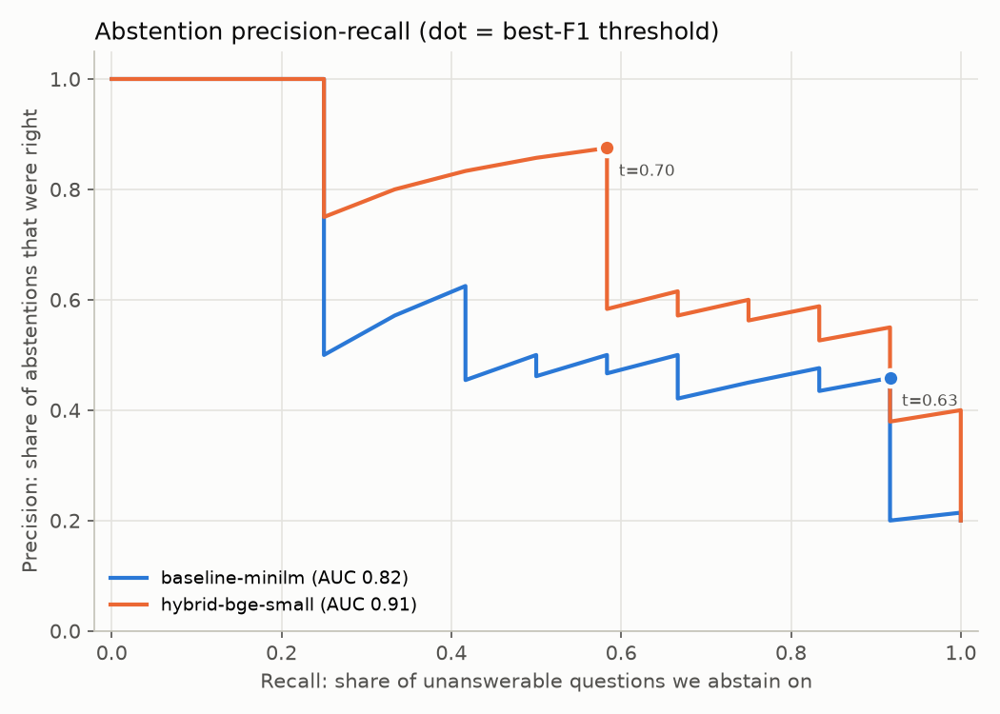

# Document Intelligence Chatbot

A local retrieval-augmented generation (RAG) chatbot for PDFs that answers only from retrieved passages, cites file, page, and position, and abstains when retrieval confidence is low. Includes an evaluation harness of 60 hand-labelled questions over public FDA drug labels, used to select the retrieval configuration and abstention threshold.

Switching from the original MiniLM dense search to hybrid BM25 + `bge-small` retrieval raised MRR@10 from 0.57 to 0.80 (+0.23, 95% CI +0.11 to +0.35) and Hit@1 from 0.42 to 0.71 (see [Results](#results)).

## Features

- **PDF ingestion** with PyMuPDF, falling back to Tesseract OCR for scanned or image-only pages. Every chunk keeps its page number and bounding boxes.
- **Hybrid retrieval**: BM25 and dense embeddings merged with reciprocal rank fusion; dense, BM25, and cross-encoder reranking configurations are also available.
- **Grounded answers** from Google Gemini using only the retrieved chunks. Citations are produced from retrieval results, not from the model's text.
- **Abstention**: returns "I don't have enough information" when the top retrieval score is below a threshold tuned on the eval set.
- **Evaluation harness**: Hit@k, MRR, bootstrap confidence intervals, paired comparisons against a baseline, and abstention precision-recall curves with cross-validated F1.

## Architecture

```
PDF ──► ingest.py ──► chunking.py ──► build_index.py ──► FAISS index + BM25 + manifest
        (PyMuPDF,     (~120-word       (bge-small
         OCR fallback, overlapping      embeddings)
         bboxes)       chunks)

question ──► retrieval.py (BM25 + dense, RRF) ──► score < threshold? ──► abstain
                                                        │ no
                                                        ▼
                                          chat.py ──► Gemini (top 4 chunks) ──► answer + citations
```

| Component | Role |
|---|---|
| PyMuPDF | Text extraction with block coordinates; renders pages for OCR without a poppler dependency |
| Tesseract (`pytesseract`) | Local OCR with word positions |
| sentence-transformers | Local embedding and cross-encoder models (`mps` on Apple Silicon) |
| `BAAI/bge-small-en-v1.5` | Default embedding model (512-token input) |
| rank-bm25 | Keyword retrieval for exact terms such as drug names, doses, and section titles |
| FAISS | `IndexFlatIP` on normalized vectors for exact cosine search |
| Google Gemini (`google-genai`, `gemini-3.8-flash`) | Answer generation |
| rapidfuzz | Fuzzy matching of evidence quotes to chunks, tolerant of OCR errors |
| matplotlib | Precision-recall curves |
| pytest, GitHub Actions | Unit tests, label-integrity tests, and a retrieval regression test |

## Results

Corpus: 5 FDA drug labels from DailyMed (Lipitor, Zoloft, Zestril, Jantoven/warfarin, metformin; 215 pages) plus a simulated 4-page scan of an amoxicillin label, for 553 chunks. Questions: 48 answerable (8 per document) and 12 unanswerable (3 off-topic or about a drug not in the corpus, 2 near-misses about drugs mentioned only as interactions, and 7 about information the labels do not contain, such as prices or veterinary use).

| Config | Hit@1 | Hit@4 | Hit@10 | MRR@10 [95% CI] | ΔMRR vs baseline [95% CI] | Abstain F1 (in-sample / 5-fold CV) | AUC | Answered w/ evidence | ms/query |
|---|---|---|---|---|---|---|---|---|---|
| baseline-minilm | 0.42 | 0.83 | 0.88 | 0.57 [0.46, 0.68] | — | 0.61 / 0.50 | 0.82 | 0.69 | 4 |
| bm25 | 0.58 | 0.83 | 0.94 | 0.71 [0.60, 0.81] | +0.14 [+0.01, +0.27] | 0.76 / 0.70 | 0.85 | 0.81 | 0 |
| dense-bge-small | 0.56 | 0.88 | 1.00 | 0.71 [0.60, 0.80] | +0.14 [+0.05, +0.23] | 0.70 / 0.50 | 0.91 | 0.85 | 7 |
| dense-bge-base | 0.50 | 0.81 | 0.96 | 0.66 [0.55, 0.76] | +0.09 [-0.00, +0.19] | 0.69 / 0.62 | 0.90 | 0.73 | 8 |
| **hybrid-bge-small** (default) | **0.71** | 0.88 | 0.98 | **0.80** [0.70, 0.88] | **+0.23** [+0.11, +0.35] | 0.70 / 0.50 | 0.91 | 0.85 | 8 |
| hybrid-bge-small+rerank | 0.56 | 0.85 | 0.94 | 0.70 [0.60, 0.80] | +0.13 [+0.02, +0.25] | 0.58 / 0.48 | 0.78 | 0.75 | 619 |
| hybrid-bge-base+rerank | 0.56 | 0.92 | 0.94 | 0.71 [0.61, 0.81] | +0.14 [+0.02, +0.26] | 0.56 / 0.45 | 0.73 | 0.79 | 646 |

*Hit@4*: the correct chunk is among the 4 sent to the LLM. *Answered w/ evidence*: an answerable question passes the abstention threshold and its evidence is in those 4 chunks. *AUC*: how well the confidence score separates answerable from unanswerable questions. Timings are on an M4 Pro using `mps`.

Findings:

- **Hybrid retrieval scored best** and clearly beats the baseline (+0.23 MRR, CI +0.11 to +0.35). Over `bge-small` alone, adding BM25 gave +0.09 MRR (CI −0.01 to +0.19); the direction is consistent, but this eval set is too small to establish the gain.
- **The cross-encoder reranker did not help.** Compared with hybrid, it changed MRR by −0.09 (CI −0.19 to 0.00; the upper bound flips sign with the bootstrap seed) at roughly 90× the latency. It also scored near-miss unanswerable questions very high: "omeprazole dose for heartburn" scored 0.99 because omeprazole is mentioned in an interaction section.
- **The larger embedding model was not better.** `bge-base` scored −0.05 MRR vs `bge-small` (CI −0.12 to +0.02).
- **OCR'd text is retrievable, but the scanned PDF is the weakest document.** On its 8 questions, hybrid ranks the correct chunk first for 5 (baseline: 2) but has it in the top 4 for only 6 (baseline: 8). OCR errors such as "pyloriinfection" likely break BM25's exact-term matches.
- **Abstention from retrieval scores alone is weak.** The chosen threshold (0.702) abstains on 7 of 12 unanswerable questions with 87.5% precision while answering 47 of 48 answerable ones, but the cross-validated F1 is only 0.50. The LLM prompt acts as a second safeguard: in a manual test, a near-miss question that passed the threshold still received "I don't have enough information" from Gemini.



Full results: [`eval/results/results.md`](eval/results/results.md) and [`eval/results/results.json`](eval/results/results.json).

## Quickstart

```bash
brew install tesseract
conda create -n doc-intelligence-chatbot python=3.11 -y
conda activate doc-intelligence-chatbot
pip install -r requirements.txt
pip install -e .
cp .env.example .env                        # add GEMINI_API_KEY
```

Index and query a set of PDFs:

```bash
cp /path/to/*.pdf data/raw_pdfs/
python -m docintel.pipeline                 # parse, chunk, embed, and index
python -m docintel.chat                     # interactive chat; 'quit' to exit
python -m docintel.search                   # retrieval rankings only, no LLM
```

The abstention threshold was tuned on drug labels with `bge-small`; for other document types, re-run the evaluation or pass `--threshold`.

Reproduce the evaluation (no API key required; downloads about 1.8 GB of models on first run, mostly the reranker):

```bash
python eval/run_eval.py                     # all 7 configs, a few minutes on an M4 Pro
python eval/run_eval.py --configs baseline-minilm hybrid-bge-small
```

## Running tests

```bash
pytest              # 27 fast tests (~1 s once the corpus is cached)
pytest -m slow      # retrieval regression tests (downloads models)
```

The fast suite covers digital and OCR parsing, bounding-box units, chunking, each retriever, save/load with a model-mismatch guard, evaluation metrics, and a check that every label's evidence exists in the parsed corpus. The slow suite asserts that the baseline and hybrid configurations stay above metric floors. CI installs Tesseract and CPU PyTorch and runs both.

## Project structure

```
src/docintel/
  config.py          Data paths, chunk sizes, default model, device selection (mps/cuda/cpu)
  ingest.py          PDF to text blocks with page and bounding box; OCR fallback
  chunking.py        Blocks to ~120-word overlapping chunks that keep their regions
  build_index.py     Embeds chunks; saves the FAISS index and a manifest with the model name
  retrieval.py       Dense, BM25, hybrid (RRF), and rerank retrievers; named configs
  pipeline.py        Runs ingest, chunking, and indexing in one command
  search.py          Retrieval-only demo for inspecting rankings
  chat.py            Retrieve, abstain or call Gemini, and cite sources
  evaluation.py      Evidence matching, Hit@k, MRR, PR curve, cross-validation, bootstrap CIs
eval/
  corpus/            5 DailyMed drug-label PDFs and 1 simulated scanned PDF
  source_pdfs/       Original label used to create the simulated scan
  download_corpus.py DailyMed set IDs and versions for every corpus PDF; re-downloads them
  make_scanned_pdf.py Converts 4 label pages into an image-only scan (skew, blur, noise)
  questions.json     60 questions with answers, source files, and evidence quotes
  run_eval.py        Runs every retrieval config and writes eval/results/
  results/           Comparison table, full metrics, PR curves, label review
tests/
  conftest.py        Shared fixture: parsed and chunked eval corpus
  test_ingest.py     Digital parsing, OCR on an image-only PDF, bbox units, line grouping
  test_chunking.py   Chunk size, overlap, page ranges, regions, edge cases
  test_retrieval.py  BM25, dense, RRF, hybrid, rerank, save/load, model-mismatch guard
  test_evaluation.py Metrics, threshold selection, cross-validation, bootstrap
  test_eval_labels.py Every label's evidence exists in the parsed corpus
  test_retrieval_regression.py Metric floors for baseline and hybrid (slow)
.github/workflows/ci.yml
pyproject.toml       Package and pytest configuration
requirements.txt     Pinned dependencies
.env.example         GEMINI_API_KEY placeholder
data/                User PDFs and generated files (not tracked)
```

## Design decisions

- **Hybrid retrieval.** Dense embeddings match meaning ("blood thinner" ≈ "anticoagulant"); BM25 matches exact strings such as drug names and doses ("2,550 mg"). Reciprocal rank fusion (`Σ 1/(60 + rank)`) combines them using ranks only, avoiding any comparison between cosine and BM25 scores.
- **`bge-small` over MiniLM.** `all-MiniLM-L6-v2` truncates input at 256 tokens, which cut off part of 46% of the chunks; `bge-small` reads 512 tokens and scored +0.14 MRR over MiniLM, at least matching `bge-base`.
- **No reranker by default**, based on the evaluation results above.
- **Abstention as classification.** The threshold is chosen from a precision-recall sweep and validated with 5-fold cross-validation, since selecting and scoring on the same data is optimistic.
- **Paired bootstrap comparisons.** Configurations are compared on the same questions, with confidence intervals on the per-question differences.
- **Pooled labelling.** Labels written in advance miss alternate correct passages, so the top-ranked chunk from every configuration was judged by hand (TREC-style pooling). Before this, all configurations were substantially undercounted (baseline Hit@1 0.23 → 0.46).
- **Consistent coordinates.** OCR boxes are converted from pixels to PDF points (`points = pixels × 72 / dpi`) so digital and scanned pages share one unit.
- **Reproducibility.** Package and model versions are pinned, the eval corpus is committed with its DailyMed versions, and each index records the model that built it; loading with a different model is rejected.
- **Citations from retrieval.** Sources are attached from retrieved chunk metadata rather than parsed from the LLM output. Gemini calls use exponential backoff on 429 and 5xx responses.

## Limitations and future work

- **Small evaluation set.** With 48 answerable questions, one question moves Hit@1 by about 2 points; differences inside the confidence intervals are not meaningful.
- **Single annotator, pooled at depth 1.** Questions and evidence quotes were written from the label text and widened by judging each configuration's top-ranked chunk (33 alternate quotes added). A second review removed 2 of those, replaced one quote that did not name the answer, corrected one expected answer, and removed an incomplete Highlights quote for q19; scores dropped slightly (hybrid MRR 0.83 → 0.80). Relevant chunks deeper in the rankings may still be unlabelled, so Hit@4 and Hit@10 are lower bounds. All labels are listed in [`eval/results/labels_review.md`](eval/results/labels_review.md).
- **Simulated scan.** The scanned document is a degraded rendering of a real label, because the FDA archive blocks scripted downloads of real scans.
- **Corpus-specific threshold.** Tuned on drug labels with `bge-small`.
- **Layout is stored but not used for ranking.** Bounding boxes appear in citations, but chunking uses word windows. On two-column pages, PyMuPDF sometimes returns bullet glyphs as separate blocks out of reading order.
- **Answer quality is not scored.** The evaluation measures retrieval and abstention, not the correctness of Gemini's final wording.
